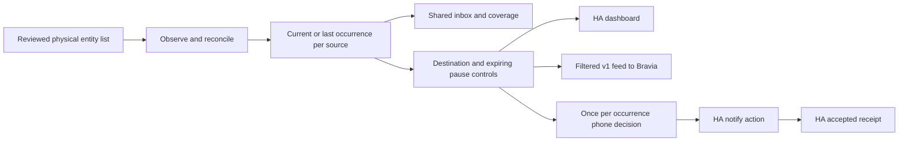

# Household attention

One shared inbox for household faults, washing and maintenance, with editable
dashboard, TV and phone delivery. Git owns detection and helper definitions;
Home Assistant restores the preferences people change day to day.

## Start here

- [User guide](household_attention_user_guide.md): everyday controls, timing and pauses.
- [Coverage catalogue](household_attention_coverage.md): all 27 source rules and exact physical mappings.
- [Implementation](household_attention.md): lifecycle, interfaces, tradeoffs and limitations.
- [Grouped-device trial](household_attention_grouped_trial.md): candidate changes, checks and deployment/acceptance gates.
- [Open PR #11](https://github.com/lachlanw-117/Wright-Home-Assistant/pull/11): review remains open through the trial.

## Current status

The Pi is trialling `e2f0bbc7adebcfca6a993c36f4ac038f355328d6`
(27 sources), including the grouped extension and short names. Hashes, HA
validation, one approved restart and old-preference continuity passed. The new
layout and physical grouping still need acceptance. Kiosk Connection Type was
subsequently observed enabled
and reporting Wi-Fi. Lachlan confirmed a successful real phone test and reported
the separately updated TV consumer working on 14 November 2026. This does not
establish every source's physical acceptance or the TV's exact installed revision.

## Architecture

HA accepting a notify action is distinct from the phone receiving it. Short
dashboard names are separate from descriptive notification titles. Grouped
lights watch the physical members because an aggregate can hide a failed bulb.
Unknown observations are coverage gaps; they are not proof of physical failure.
Detection does not operate devices or introduce repair actions.

This is AI-assisted household configuration. The local checks exercise production
functions, but do not replace HA validation or real household observations.
Existing third-party attribution remains in the repository's LICENSE and NOTICE.

## Historical installation evidence

- [Initial nine-source installation](household_attention_trial.md), `6b36c4a`.
- [Living-room pair extension](household_attention_living_room_trial.md), `3cc4573`.
- [Original accepted handoff](household_attention_accepted_handoff.txt), superseded where later decisions are recorded.

Historical installation counts and preferences describe those trial moments.
They are not declarations of today's UI values.

## Screenshots

Capture Dashboard, Inbox and Delivery controls after the new layout is installed
and visually accepted. Review images for phone identifiers, SSID/BSSID, private
messages, tokens and unrelated household data before committing. No screenshot
is supplied yet: the installed layout has not been visually accepted.
